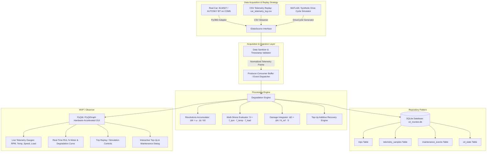

# Minimal Design Specification: Algorithmic Engine Oil Life Monitoring (OLM) and Predictive Maintenance System via OBD-II Data Streams

**Project:** Bachelor Thesis - Practical Case Study & System Prototype  
**Author / Student:** Mitrea Vladut-Cristian  
**Academic Supervisor:** Constantin-Renato Ivănescu  
**Faculty:** Faculty of Automation, Computers and Electronics  
**Target Platform:** 2004 Skoda Fabia 1.4L (ISO 9141-2 K-Line ECU)  

---

## 1. Executive Summary & Scope

Modern automotive maintenance paradigms are transitioning from rigid, distance-based service intervals (e.g., standard 10,000–15,000 km or 12-month intervals) to dynamic, condition-based predictive maintenance. 

Vehicles operating in urban environments encounter frequent stop-and-go driving, prolonged cold-start conditions, and thermal fluctuations that accelerate lubricant breakdown through:
1. **Mechanical Shear:** High RPM causing viscosity breakdown and polymer chain rupture.
2. **Thermal Oxidation:** Excessive engine oil/coolant temperatures leading to thermal decomposition and sludge.
3. **Condensation & Fuel Dilution:** Incomplete combustion and cold operating temperatures ($T_{coolant} < 70^\circ\text{C}$) preventing moisture and unburnt hydrocarbons from evaporating out of the crankcase.
4. **Engine Torque Stress:** Sustained high calculated load accelerating additive depletion.

The target vehicle is a **2004 Skoda Fabia 1.4L** lacking continuous physical oil quality or dielectric sensors. This system acquires engine telemetry via standard OBD-II PIDs over an ELM327 interface, ingests synthetic MATLAB/scripted drive cycles, integrates a multi-variable stress-weighted degradation algorithm, and estimates the **Remaining Useful Life (RUL, %)** in real time, with physical additive replenishment compensation during oil top-ups.

---

## 2. Requirements & Traceability Matrix

### 2.1 Functional Requirements (FR)

| ID | Requirement Specification | Architecture Component |
| :--- | :--- | :--- |
| **FR1** | Continuously poll and parse RPM (`0x0C`), Vehicle Speed (`0x0D`), Coolant Temperature (`0x05`), and Calculated Engine Load (`0x04`) from the ECU. | `OBDDataSource`, `TelemetryPoller` |
| **FR2** | Derive cumulative engine run-time and sample duration ($\Delta t$) in software. | `DataSanitizer`, `TelemetrySample` |
| **FR3** | Ingest telemetry transparently from the real car, MATLAB drive-cycle exports, and CSV logs via a unified interface. | `IDataSource` (Strategy Pattern) |
| **FR4** | Compute oil RUL (%) continuously using cumulative mechanical and thermal stress integrals. | `DegradationEngine` |
| **FR5** | Log manual oil top-ups ($V_{add}$) and complete oil changes, updating oil state via the additive recovery model. | `OilStateManager`, `SQLiteRepository` |
| **FR6** | Persist historical trip telemetry and degradation logs; render live visual gauges, degradation curves, and predictive alerts. | `SQLiteRepository`, `PyQtDashboard` |

### 2.2 Non-Functional Requirements (NFR)

| ID | Non-Functional Requirement | Implementation Mechanism |
| :--- | :--- | :--- |
| **NFR1** | **Sampling Rate:** Maintain $\ge 2\text{ Hz}$ query rate over high-latency ISO 9141-2 K-Line. | Prioritized async polling loop, stagger delays ($50\text{ ms}$), fallback caching. |
| **NFR2** | **Configurable Parameters:** Model coefficients, reference budgets, and vehicle parameters must be dynamically configurable. | `VehicleProfile`, `OilConfig` dataclasses loaded from JSON/SQLite. |
| **NFR3** | **Simulation Reproducibility:** Simulation drive cycles must be deterministic and scriptable. | `DriveCycleSimulator` with predefined cycles (Cold Short Trip, Highway Cruise, Aggressive, Urban). |
| **NFR4** | **Modular & Unit-Tested Architecture:** Clean decoupling of acquisition, math, storage, and UI layers. | Strict Layered Architecture, $\ge 90\%$ pytest coverage on core degradation logic. |

---

## 3. System Architecture & Design Patterns

The system adheres to a decoupled, modular 5-tier architecture:



### 3.1 Design Patterns Employed

1. **Strategy Pattern (`IDataSource`):** Isolates the origin of OBD-II telemetry. The degradation engine consumes standard telemetry frames regardless of whether data originates from `OBDSerialSource`, `CSVReplaySource`, or `MATLABCycleSource`.
2. **Repository Pattern (`StorageRepository`):** Encapsulates all SQLite CRUD operations, providing transactional guarantees for trip sessions, high-frequency samples, and oil maintenance history.
3. **Observer / Signal-Slot Pattern (PyQt6):** Decouples background telemetry streaming threads from the GUI rendering thread, ensuring responsive updates without UI freezing.
4. **Adapter Pattern:** Wraps `python-obd` command queries and serial frame parsing into uniform domain entities.

---

## 4. Mathematical Degradation & Additive Recovery Formulation

### 4.1 Instantaneous Degradation Rate & Stress Factor

For each discrete sample $k$ with interval $\Delta t_k = t_k - t_{k-1}$ (seconds), the engine revolutions increment $\Delta N_k$ is computed as:

$$\Delta N_k = \frac{\omega_k \cdot \Delta t_k}{60}$$

Where $\omega_k$ is the instantaneous engine speed in RPM.

The reference revolution budget $N_{ref}$ is defined by the baseline oil mileage rating $L_{base}$ and the nominal engine revs per kilometer $\rho_{ref}$:

$$N_{ref} = L_{base} \cdot \rho_{ref}$$

*Typical baseline values:*
- Fully Synthetic Oil: $L_{base} = 15,000\text{ km}$, $\rho_{ref} = 2,500\text{ rev/km} \implies N_{ref} = 37.5 \times 10^6\text{ revs}$
- Semi-Synthetic Oil: $L_{base} = 10,000\text{ km}$, $\rho_{ref} = 2,500\text{ rev/km} \implies N_{ref} = 25.0 \times 10^6\text{ revs}$
- Mineral Oil: $L_{base} = 5,000\text{ km}$, $\rho_{ref} = 2,500\text{ rev/km} \implies N_{ref} = 12.5 \times 10^6\text{ revs}$

The instantaneous composite stress factor $S_k$ combines three dimensionless penalty multipliers:

$$S_k = M_{RPM}(\omega_k) \cdot M_{Temp}(T_k) \cdot M_{Load}(L_k)$$

#### A. Mechanical Shear Multiplier ($M_{RPM}$):
Accounts for viscosity breakdown and extreme shear at elevated engine speeds:

$$M_{RPM}(\omega) = \begin{cases} 
1.0 & \text{if } \omega \le 3500\text{ RPM} \\ 
1.0 + \left(\frac{\omega - 3500}{1000}\right)^2 & \text{if } \omega > 3500\text{ RPM} 
\end{cases}$$

#### B. Thermal & Fuel Dilution Multiplier ($M_{Temp}$):
Penalizes low-temperature operating regimes (condensation of water and fuel blow-by below $70^\circ\text{C}$) and excessive thermal oxidation ($> 100^\circ\text{C}$):

$$M_{Temp}(T) = \begin{cases} 
2.0 & \text{if } T < 70^\circ\text{C} \quad \text{(Cold start / Short trip condensation)} \\ 
1.0 & \text{if } 70^\circ\text{C} \le T \le 100^\circ\text{C} \quad \text{(Optimal operating window)} \\ 
1.5 & \text{if } T > 100^\circ\text{C} \quad \text{(Thermal stress & accelerated oxidation)} 
\end{cases}$$

#### C. Engine Torque / Load Multiplier ($M_{Load}$):
Scales linearly with calculated engine load percentage $L \in [0, 100]\%$:

$$M_{Load}(L) = 0.8 + 0.4 \cdot \left(\frac{L}{100}\right)$$

*Boundary conditions:* $M_{Load}(0\%) = 0.8$, $M_{Load}(50\%) = 1.0$, $M_{Load}(100\%) = 1.2$.

### 4.2 Incremental Damage & RUL Integration

The fractional damage $\Delta D_k$ accrued during sample interval $k$ is:

$$\Delta D_k = \frac{\Delta N_k}{N_{ref}} \cdot S_k$$

The cumulative damage $D(T)$ after total operating time $T$ is the discrete summation:

$$D(T) = D_0 + \sum_{k=1}^M \Delta D_k$$

The **Remaining Useful Life ($RUL, \%$)** is:

$$RUL(T) = \max\left(0.0, \; 100 \cdot (1 - D(T))\right)$$

### 4.3 Additive Concentration Recovery via Oil Top-Up

When fresh engine oil volume $V_{add}$ is added to an engine crankcase with sump capacity $V_s$ (e.g. $3.7\text{ L}$ for the Skoda Fabia 1.4L), fresh additives mix with the aged oil.

Accounting for a physical mixing efficiency $\eta \in (0.0, 1.0]$ (nominally $\eta = 0.95$ to account for insoluble sludge and unmixed sump deposits):

$$D_{new} = D_{prior} \cdot \left(1 - \eta \cdot \frac{V_{add}}{V_s}\right)$$

Equivalently, expressed in terms of Oil Health / RUL percentage ($H = 100 \cdot (1 - D)$):

$$H_{new} = \frac{(V_s - \eta \cdot V_{add}) \cdot H_{prior} + (\eta \cdot V_{add}) \cdot 100}{V_s}$$

For a complete oil change ($V_{add} = V_s$, $\eta = 1.0$):
$$D_{new} = 0.0 \implies RUL_{new} = 100.0\%$$

---

## 5. Persistence & SQLite Relational Schema

```sql
-- Vehicle configuration and active oil state
CREATE TABLE IF NOT EXISTS oil_state (
    id INTEGER PRIMARY KEY CHECK (id = 1),
    vehicle_model TEXT NOT NULL DEFAULT 'Skoda Fabia 1.4L',
    sump_capacity_liters REAL NOT NULL DEFAULT 3.7,
    oil_type TEXT NOT NULL DEFAULT 'Semi-Synthetic',
    base_mileage_km REAL NOT NULL DEFAULT 10000.0,
    revs_per_km REAL NOT NULL DEFAULT 2500.0,
    cumulative_revolutions REAL NOT NULL DEFAULT 0.0,
    cumulative_damage REAL NOT NULL DEFAULT 0.0,
    current_rul_percent REAL NOT NULL DEFAULT 100.0,
    total_engine_hours REAL NOT NULL DEFAULT 0.0,
    total_distance_km REAL NOT NULL DEFAULT 0.0,
    last_updated TIMESTAMP DEFAULT CURRENT_TIMESTAMP
);

-- Trip sessions
CREATE TABLE IF NOT EXISTS trips (
    trip_id INTEGER PRIMARY KEY AUTOINCREMENT,
    source_type TEXT NOT NULL,          -- 'OBD_LIVE', 'CSV_REPLAY', 'SIMULATION'
    scenario_name TEXT,                 -- e.g. 'Cold Short-Trip', 'Highway Steady'
    start_time TIMESTAMP NOT NULL,
    end_time TIMESTAMP,
    duration_seconds REAL DEFAULT 0.0,
    distance_km REAL DEFAULT 0.0,
    initial_rul REAL NOT NULL,
    final_rul REAL,
    rul_drop_percent REAL DEFAULT 0.0
);

-- High-frequency telemetry samples
CREATE TABLE IF NOT EXISTS telemetry_samples (
    sample_id INTEGER PRIMARY KEY AUTOINCREMENT,
    trip_id INTEGER NOT NULL,
    timestamp TIMESTAMP NOT NULL,
    rpm REAL NOT NULL,
    speed_kmh REAL NOT NULL,
    coolant_temp_c REAL NOT NULL,
    engine_load_pct REAL NOT NULL,
    delta_t REAL NOT NULL,
    stress_factor REAL NOT NULL,
    incremental_damage REAL NOT NULL,
    current_rul REAL NOT NULL,
    FOREIGN KEY(trip_id) REFERENCES trips(trip_id)
);

-- Maintenance & Top-Up Events
CREATE TABLE IF NOT EXISTS maintenance_events (
    event_id INTEGER PRIMARY KEY AUTOINCREMENT,
    event_type TEXT NOT NULL,           -- 'TOP_UP' or 'FULL_CHANGE'
    timestamp TIMESTAMP DEFAULT CURRENT_TIMESTAMP,
    volume_liters REAL NOT NULL,
    oil_grade TEXT NOT NULL,
    mixing_efficiency REAL NOT NULL DEFAULT 0.95,
    rul_before REAL NOT NULL,
    rul_after REAL NOT NULL,
    notes TEXT
);
```

---

## 6. Prototype Demonstration Protocol

To satisfy Section 6 of the academic specifications, the prototype verifies the end-to-end chain through three reproducible validation phases:

```
[Phase 1: Dual Data Replay]
  ├── A: Stream real Skoda Fabia telemetry from 'car_telemetry_log.csv'
  └── B: Run synthetic MATLAB drive cycle through the identical degradation pipeline
  └── Result: Identical ingestion contract, smooth numerical accumulation.

[Phase 2: Stress Comparison]
  ├── Scenario A (Cold Short Trip): T_coolant = 45-65°C, Stop & Go (0-40 km/h), High Idle
  ├── Scenario B (Steady Highway): T_coolant = 88-92°C, 90-120 km/h, Low RPM
  └── Result: Quantitative proof that RUL(%) drops significantly faster on cold short trips
              due to thermal penalty (2.0x) and frequent acceleration transients.

[Phase 3: Additive Replenishment Verification]
  ├── Simulate 1.0 L oil top-up on an oil state degraded to ~70% RUL
  └── Result: Immediate additive recovery step in RUL(%) curve from 70% to ~77.4%,
              followed by updated baseline degradation slope.
```
